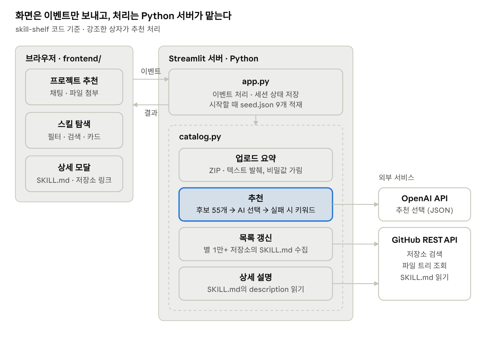

# [일단 해보조] Tech Spec — Skill Shelf

Nov 24, 2026 · @안태훈

## 1. 개요 (Overview)

Skill Shelf는 Python Streamlit 앱 하나가 디자인 시안 HTML을 커스텀 컴포넌트로 띄우고, 화면에서 올라온 이벤트(추천·목록 갱신·상세)를 Python이 처리해 다시 화면에 넘겨주는 구조입니다. 외부 서비스는 OpenAI와 GitHub API 두 가지이고, 별도 DB 없이 세션 상태에만 저장합니다. 제품 요구사항은 짝 문서인 PRD를 따르며, 이 문서는 구현 코드 skill-shelf를 기준으로 작성했습니다.

**기술적 맥락.** AI 스킬은 SKILL.md 파일이 든 폴더로, 파일 앞부분(YAML)에 name·description이 있고 본문에 작업 지침이 있습니다. 널리 쓰이는 스킬 묶음은 anthropics/skills, obra/superpowers, vercel-labs/agent-skills 같은 GitHub 저장소에 있어, GitHub API와 별 수를 기준으로 믿을 만한 목록을 만들 수 있습니다.

**개발 조건.** Python 3.10 이상, Python 패키지는 streamlit(1.49 이상) 하나뿐이고 HTTP 호출은 표준 라이브러리(urllib)로 합니다. 화면은 시안의 HTML·CSS·JS를 빌드 없이 그대로 씁니다.

**용어.**

- **커스텀 컴포넌트** — Streamlit 안에 띄우는 직접 만든 HTML 화면(frontend/). Python과 메시지를 주고받음
- **이벤트** — 화면이 Python에 보내는 요청(recommend, refresh, detail)
- **렌더 인자** — Python이 화면에 넘기는 데이터(목록, 대화, 모드, 안내 문구)
- **카탈로그** — 화면에 보여 주는 스킬 목록. 시작은 seed.json 스냅샷 9개, 갱신하면 GitHub에서 다시 모음
- **모드** — OpenAI 키가 있으면 ai(AI 연결됨), 없으면 rules(키워드 추천)

## 2. 목표 (Goals)

기술 목표는 '빠르고, 외부 API가 실패해도 멈추지 않고, 목록에 없는 스킬을 지어내지 않는 추천'을 의존성 하나짜리 Streamlit 앱으로 구현하는 것입니다.

| 목표 | 측정 기준 | 코드에서 지키는 방법 |
|---|---|---|
| 단순한 실행·배포 | pip install 후 streamlit run app.py 한 줄로 실행 | requirements.txt에 streamlit만, 나머지는 표준 라이브러리 |
| 응답 속도 | 전송~추천 표시 10회 중 9회 15초 이내 | OpenAI 호출 1회, 후보 55개·설명 260자로 입력 축소, 출력 1,000토큰 |
| 목록 밖 추천 0건 | 화면에 나온 추천이 모두 카탈로그에 존재 | 후보에 정수 번호를 붙여 보내고, 범위 밖·중복 번호는 버림 |
| 장애 시에도 동작 | 키 없음·AI 실패·GitHub 실패에서 화면 유지 | 키워드 추천으로 대체, 갱신 실패 시 기존 목록 유지 |
| 업로드 원본 미저장 | 파일이 디스크·세션에 남지 않음 | 메모리에서 발췌만 만들고 원본은 버림 |
| 비밀값 보호 | AI에 키·비밀번호가 전송되지 않음 | 위험 파일명 거부, 발췌의 비밀값을 [가림]으로 치환 |
| 시안 그대로 구현 | 화면이 Skill_Shelf_Preview.html과 같음 | 시안 스크립트와 frontend/app.js가 동일(시안은 독립 실행 시 예시 추천 모드) |

## 3. 제안된 솔루션 (Proposed Solution)

추천은 '키워드 점수로 후보 55개를 추리고, OpenAI가 그중 최대 4개를 골라 이유를 다는' 2단계 방식입니다. AI는 후보 번호로만 답할 수 있어 없는 스킬을 지어낼 수 없고, AI가 실패하면 같은 점수로 바로 대체합니다.

**A. 추천 흐름 (recommend 이벤트)**

1. **입력 전송** — 화면(app.js)이 설명과 파일(Base64)을 이벤트로 보냅니다. 파일 개수·크기는 화면에서 먼저 검사합니다.
2. **입력 정리** — 설명은 6,000자, 파일은 3개까지만 받습니다.
3. **업로드 요약 (summarize_uploads)** — 형식·경로·크기를 다시 검사하고, 텍스트는 앞 4KB에서 1,600자, ZIP은 파일 목록 80개와 주요 설정 파일 4개를 발췌해 비밀값을 가립니다(합계 9,500자).
4. **맥락 합치기** — 이번 입력과 요약에 '이전 대화의 프로젝트 정보'를 붙여 최대 20,000자로 만듭니다.
5. **후보 추리기 (find_candidates)** — 카탈로그 전체에 아래 점수를 매겨 점수·별 수 순으로 정렬합니다.
6. **AI 선택 (ask_openai)** — 상위 55개를 0부터 번호를 붙여 OpenAI Responses API로 보내고, JSON 스키마(strict)로 '안내 메시지 + 번호·이유 최대 4개'를 받습니다.
7. **검증** — 범위 밖·중복 번호는 버리고, 이유 400자·메시지 700자로 자릅니다.
8. **대체** — 키가 없거나 요청·해석에 실패하면 점수 1 이상인 상위 3개를 스킬 설명과 함께 내고, 하나도 없으면 더 구체적인 설명을 요청합니다.
9. **저장·다시 그리기** — 대화를 세션에 더하고(최근 24개), 프로젝트 정보를 누적(7,000자)한 뒤 화면을 다시 그립니다(st.rerun).

**후보 점수 공식** (5단계)

```
\mathrm{score}(s) = \sum_{t \in T} \begin{cases} 3 & t \text{ in } N_s \\ 1 & t \text{ in } D_s \\ 0 & \text{otherwise} \end{cases}
```

T는 입력에서 뽑은 2글자 이상 단어, N_s는 스킬 이름과 파일 경로, D_s는 태그와 설명입니다. 이름에 나오는 단어에 3배 가중치를 줍니다.

**B. 목록 갱신 흐름 (refresh 이벤트, refresh_catalog)**

1. **저장소 검색** — 검색어 8종(토픽 agent-skills·claude-skills·codex-skills·claude-code-skills·agentskills, 이름·설명의 "agent skills"·"claude skills"·"SKILL.md")에 '별 10,000 이상, 보관·포크 제외' 조건을 붙여 검색합니다.
2. **누락 보완** — 검색에서 빠진 시드 저장소는 저장소 정보를 직접 조회해 다시 확인합니다.
3. **SKILL.md 찾기** — 별 수 순으로 각 저장소의 기본 브랜치 파일 트리를 받아 SKILL.md 파일을 모두 찾습니다(심볼릭 링크·서브모듈 제외).
4. **스킬 만들기** — 폴더 이름으로 스킬 이름을, 경로·저장소 토픽으로 카테고리를 정하고, 시드에 있는 스킬은 한국어 설명을 그대로 씁니다.
5. **정렬·보고** — 별 수 순으로 정렬하고 '저장소 N개 확인'과 누락 가능성(검색 결과 일부만 반환, 1,000개 제한, 호출 한도)을 안내합니다. 하나도 못 모으면 기존 목록을 유지합니다.

**C. 상세 설명 흐름 (detail 이벤트, fetch_description)** — 갱신으로 새로 들어온 스킬은 설명이 비어 있어(detail_pending), 상세를 열 때만 SKILL.md를 받아 YAML의 description(최대 750자)을 채웁니다. 목록 갱신 때 수백 번의 파일 요청을 피하기 위한 지연 로딩입니다.

## 4. 시스템 아키텍처 (Architecture)



Skill Shelf 구조 · 화면 3개, 서버 모듈 5개, 외부 API 2개

화면은 이벤트(recommend·refresh·detail)만 보내고, app.py가 catalog.py를 불러 처리한 뒤 결과를 렌더 인자로 돌려보냅니다. 외부 호출은 추천 때 OpenAI 1회, 목록 갱신·상세 때 GitHub뿐입니다.

| 구성 요소 | 파일·함수 | 역할 |
|---|---|---|
| 브라우저 화면 | frontend/index.html, style.css, app.js | 채팅·카탈로그·모달 그리기, 파일 Base64 변환, 이벤트 전송 |
| 앱 서버 | app.py (handle_event) | 이벤트 처리, 세션 상태 관리, 렌더 인자 전달, 처리 후 다시 그리기 |
| 업로드 요약 | catalog.py summarize_uploads | 파일 검사·발췌·비밀값 가림 |
| 추천 | catalog.py recommend, find_candidates, ask_openai | 후보 추리기, OpenAI 선택, 키워드 대체 |
| 목록 갱신 | catalog.py refresh_catalog, list_repo_skills, categorize | GitHub 검색, SKILL.md 수집, 카테고리 분류 |
| 상세 설명 | catalog.py fetch_description | SKILL.md description 지연 로딩 |
| 초기 목록 | seed.json | 앱 시작 시 보여 줄 스킬 9개 |

## 5. 데이터 모델 (Data Model)

DB는 없고, 모든 데이터는 Streamlit 세션 상태(st.session_state)에 파이썬 딕셔너리로 보관합니다. 영구 데이터는 초기 목록 파일 seed.json 하나뿐이며, 업로드 파일 원본은 어디에도 남기지 않습니다.

**스킬 (Skill)** — 카탈로그의 한 항목. 고유 ID는 저장소:경로(skill_id)입니다.

| 필드 | 타입 | 설명 | 예시 |
|---|---|---|---|
| repo | str | GitHub 저장소 (소유자/이름) | anthropics/skills |
| path | str | 저장소 안 SKILL.md 경로 | skills/pdf/SKILL.md |
| branch | str | 기본 브랜치 (없으면 main) | main |
| stars | int | 저장소 별 수 (스킬이 아닌 저장소 기준) | 199600 |
| name | str | 표시 이름 (폴더 이름을 제목화) | PDF |
| category | str | 7개 중 하나 (아래) | documents |
| description | str | 한국어 설명(시드) 또는 저장소 소개·SKILL.md 설명 | PDF의 텍스트와 표를 추출합니다. |
| tags | str | 검색용 단어 (시드는 한·영 키워드, 갱신분은 저장소 토픽) | python pdf report |
| detail_pending | bool | true면 상세를 열 때 SKILL.md 설명을 불러옴 | false |

**카테고리** — frontend(프론트엔드), design(디자인), backend(백엔드), testing(테스트·디버깅), workflow(개발 워크플로), documents(문서·데이터), other(기타). 분류는 경로의 단어를 카테고리별 키워드 목록(CATEGORY_TERMS)과 비교해 가장 많이 겹치는 것으로, 없으면 저장소 토픽으로 정합니다.

**대화 메시지 (Message)**

```
{
  "role": "assistant",
  "text": "랜딩 페이지 디자인과 브라우저 테스트에 맞는 스킬입니다.",
  "recommendations": [
    {
      "id": "anthropics/skills:skills/frontend-design/SKILL.md",
      "reason": "레이아웃·타이포그래피를 다듬는 지침이 있어 랜딩 페이지 완성도를 높입니다.",
      "skill": { "repo": "anthropics/skills", "path": "skills/frontend-design/SKILL.md", "...": "Skill 전체" }
    }
  ]
}
```

role이 user인 메시지는 text만 갖고, 첨부가 있으면 '첨부 · 파일명'이 붙습니다.

**세션 상태 (st.session_state)**

| 키 | 내용 | 초깃값 | 한도 |
|---|---|---|---|
| catalog | Skill 목록 | seed.json 9개 | GitHub 갱신 결과 전체 |
| messages | Message 목록 | 빈 목록 | 최근 24개 |
| previous | 누적된 프로젝트 정보 (다음 추천의 맥락) | 빈 문자열 | 7,000자 |
| source | 목록 출처 문구 | 초기 목록 · GitHub 저장소 별 스냅샷 | — |
| processed | 마지막으로 처리한 이벤트 ID (중복 처리 방지) | 빈 문자열 | — |
| detail | 상세 설명 응답 {id, description} | None | — |
| chat_notice, catalog_notice | 대화·목록 영역 안내 문구 | 빈 문자열 | — |

## 6. API 설계 (API Design)

별도 REST 서버는 없고, 인터페이스는 ① 화면과 Python 사이의 컴포넌트 메시지, ② catalog.py 함수, ③ 외부 API 세 층입니다. 프론트 담당과 백엔드 담당은 ①의 형식만 지키면 따로 작업할 수 있습니다.

**①-1 이벤트 (화면 → Python)** — 모든 이벤트는 { id, action, ... } 형식이고, id는 화면이 만드는 무작위 UUID입니다. Python은 processed와 같은 id를 다시 처리하지 않습니다.

| action | 보내는 때 | 추가 필드 | Python 처리 | 바뀌는 렌더 인자 |
|---|---|---|---|---|
| recommend | '추천 받기' 또는 Enter | prompt: str, files: [{name, content(Base64)}] | summarize_uploads → recommend | messages, chat_notice |
| refresh | 'GitHub에서 불러오기' | — | refresh_catalog | catalog, source, catalog_notice |
| detail | 상세를 열 때(detail_pending인 스킬만) | skill: skill_id | fetch_description | detail, catalog |

**①-2 렌더 인자 (Python → 화면)** — catalog, messages, source, mode('ai' 또는 'rules'), processed, detail, chat_notice, catalog_notice. 화면은 processed가 자기가 보낸 이벤트 id와 같아지면 로딩 상태를 풀고 안내 문구를 표시합니다.

```
// 이벤트 예시 (recommend)
{
  "id": "3f9c2a1e-...",
  "action": "recommend",
  "prompt": "랜딩 페이지를 만들고 있어요. 화면 디자인을 다듬고 브라우저에서 동작을 테스트하고 싶어요.",
  "files": [{ "name": "project.zip", "content": "UEsDBBQAAAAI..." }]
}
```

**② catalog.py 공개 함수**

| 함수 | 입력 | 출력 | 실패 시 |
|---|---|---|---|
| summarize_uploads(files) | [{name, content}] | (요약 문자열 ≤ 9,500자, 오류 문구) | 문제 파일만 빼고 오류 문구로 반환 |
| recommend(catalog, context, token) | 목록, 맥락 ≤ 20,000자, OpenAI 키 | (안내 메시지, [(스킬, 이유)], 안내 문구) | 안에서 키워드 추천으로 대체 |
| refresh_catalog() | — | (목록, 확인한 저장소 수, 누락 안내) | ServiceError |
| fetch_description(skill) | Skill | SKILL.md description ≤ 750자 | ServiceError |
| skill_id(skill) | Skill | '저장소:경로' | — |

**③ 외부 API**

| 서비스 | 요청 | 용도 | 인증 |
|---|---|---|---|
| OpenAI | POST /v1/responses | 후보 중 추천 선택 (구조화 출력, store: false) | OPENAI_API_KEY (필수, 없으면 키워드 모드) |
| GitHub | GET /search/repositories | 스킬 저장소 검색 (별 순, 페이지당 100개) | GITHUB_TOKEN (선택, 호출 한도 완화) |
| GitHub | GET /repos/{owner}/{repo} | 시드 저장소 별 수 재확인 | GITHUB_TOKEN (선택) |
| GitHub | GET /repos/{owner}/{repo}/git/trees/{branch}?recursive=1 | SKILL.md 파일 찾기 | GITHUB_TOKEN (선택) |
| GitHub | GET /repos/{owner}/{repo}/contents/{path} | SKILL.md 설명 읽기 | GITHUB_TOKEN (선택) |

```
// OpenAI 응답 스키마 (strict)
{
  "message": "string",
  "recommendations": [ { "id": 0, "reason": "string" } ]
}
```

**오류 처리** — 외부 요청 실패는 모두 ServiceError로 모아 한국어 문구로 보여 주고, 화면은 멈추지 않습니다.

| 상황 | 화면 문구 | 동작 |
|---|---|---|
| GitHub 403·429 | API 요청 한도 또는 접근 제한에 도달했습니다. | 기존 목록 유지 |
| GitHub 연결 실패 | GitHub에 연결할 수 없습니다. 잠시 후 다시 시도하세요. | 기존 목록 유지 |
| OpenAI 요청·해석 실패 | AI 연결에 실패해 키워드 기준으로 추천했습니다. | 키워드 추천 |
| 지원하지 않는 파일 | ○○은(는) 분석할 수 없는 형식입니다. | 그 파일만 제외 |
| 크기 초과·깨진 파일 | ○○ 파일을 읽을 수 없습니다. | 그 파일만 제외 |
| SKILL.md 읽기 실패 | SKILL.md 설명을 가져오지 못했습니다. | 기존 설명 + 안내 |

## 7. 기술 스택 (Tech Stack)

Python Streamlit + 빌드 없는 HTML 커스텀 컴포넌트 + OpenAI·GitHub API 조합입니다. 설치할 패키지가 streamlit 하나뿐이라 팀원 누구나 같은 환경을 바로 만들 수 있고, 시안 HTML을 그대로 쓸 수 있습니다.

| 영역 | 기술 / 라이브러리 | 용도 | 선택 이유 | 담당 |
|---|---|---|---|---|
| 앱 프레임워크 | Python 3.10+, Streamlit 1.49+ | 서버, 세션 상태, 컴포넌트 로딩 | 백엔드 로직을 Python 하나로 작성, 실행·배포가 간단 | 박재빈 |
| 화면 | HTML·CSS·JavaScript(프레임워크·빌드 없음), Streamlit 커스텀 컴포넌트(declare_component) | 채팅·카탈로그·모달 | 시안을 그대로 옮기고 기본 위젯보다 디자인 자유도가 높음 | 안태훈 |
| 디자인 | 시안 토큰(배경 #F6F6F4, 글자 #171816, 강조 #D9F44C), Inter·Pretendard·IBM Plex Mono | 화면 스타일, .streamlit/config.toml 테마 | 시안과 Streamlit 바탕색을 일치 | 임소연 |
| AI | OpenAI Responses API, 기본 모델 gpt-4.1-mini | 추천 선택·이유 작성 | 구조화 출력(JSON 스키마)으로 형식 오류를 줄임, 모델은 OPENAI_MODEL로 교체 | 박재빈 |
| 데이터 수집 | GitHub REST API | 스킬 저장소 검색, SKILL.md 수집 | 공식 API, 별 수로 신뢰 기준 적용 | 박재빈 |
| HTTP·파일 처리 | urllib, zipfile, base64, re (표준 라이브러리) | API 호출, ZIP 분석, 비밀값 가림 | 추가 설치 없음 | 박재빈 |
| 저장 | st.session_state, seed.json | 대화·목록 보관, 초기 목록 | DB 없이 시연 범위를 충분히 충족 | 박재빈 |
| 배포 (제안) | Streamlit Community Cloud | 최종 발표용 공개 주소 | 무료, GitHub 저장소에서 바로 배포 | 안태훈 |
| 테스트 (제안) | pytest, Playwright | 단위·화면 테스트 | 아직 저장소에 없어 추가 필요 | 박재빈·안태훈 |
| 개발 도구 | Claude Code 또는 Cursor, GitHub | 원프롬프트 구현·협업 | 프로젝트 주제인 바이브 코딩 방식 그대로 개발 | 전원 |

**환경변수** — OPENAI_API_KEY(없으면 키워드 모드), OPENAI_MODEL(선택, 기본 gpt-4.1-mini), GITHUB_TOKEN(선택, 목록 갱신의 호출 한도 완화). 키는 서버 환경변수나 배포 플랫폼의 비밀값 설정에만 넣고 저장소에 올리지 않습니다.

**실행** — python -m pip install -r requirements.txt 후 python -m streamlit run app.py.

**폴더 구조**

```
skill-shelf/
  app.py                    Streamlit 진입점: 이벤트 처리(handle_event), 세션 상태, 컴포넌트 렌더
  catalog.py                핵심 로직: GitHub 수집, 분류, 업로드 요약, 추천, OpenAI 호출
  seed.json                 초기 스킬 9개 (한국어 설명·태그)
  requirements.txt          streamlit>=1.49,<2
  .streamlit/config.toml    테마 색상, 사용 통계 끄기
  frontend/
    index.html              화면 구조 (시안과 동일)
    style.css               스타일
    app.js                  화면 동작, Streamlit 메시지 송수신
  Skill_Shelf_Preview.html  디자인 시안 (단독 실행 시 예시 추천)
  README.md
```

## 8. 대안 검토 (Alternatives Considered)

네 가지 결정 모두 '1주 안에 4명이 시연 가능한 수준으로 완성'하는 쪽을 골랐고, 대신 동시 사용자 처리와 데이터 보존은 다음 단계로 미뤰습니다.

**앱 구성**

| 방식 | 장점 | 단점 | 결정 |
|---|---|---|---|
| Next.js + 별도 DB(초기 기획안) | 동시 사용자에 강하고 화면 반응이 빠름 | 담당자 모두 TypeScript·DB 설정 필요, 구성 요소가 많음 | 기각 |
| Streamlit 기본 위젯만 | 코드가 가장 짧음 | 시안 디자인(채팅 패널, 카드, 모달)을 재현하기 어려움 | 기각 |
| Streamlit + 커스텀 HTML 컴포넌트 | 로직은 Python, 화면은 시안 그대로, 의존성 1개 | 이벤트마다 앱 전체가 다시 실행(rerun)되고, 처리 중에는 대기 | **채택** |

**추천 방식**

| 방식 | 장점 | 단점 | 결정 |
|---|---|---|---|
| 키워드 점수만 | 빠르고 비용 0원, 키 없이 동작 | 맥락을 못 읽고 이유가 스킬 설명의 반복 | 대체 모드로 사용 |
| 카탈로그 전체를 AI에 전달 | 구현이 가장 쉬움 | 갱신 후 목록이 커지면 비용·지연 증가 | 기각 |
| 임베딩 벡터 검색 | 뜻이 비슷한 스킬까지 찾음 | 임베딩 저장소가 더 필요하고 현재 전체 규모에는 과함 | 다음 단계 |
| 키워드 후보 55개 + OpenAI 구조화 출력 | 입력 크기 고정, 번호로만 답해 목록 밖 추천 불가, 실패 시 같은 점수로 대체 | 후보 55개에 없는 스킬은 AI가 볼 수 없음 | **채택** |

**카탈로그 출처**

| 방식 | 장점 | 단점 | 결정 |
|---|---|---|---|
| 디렉터리 사이트 수집(skills.sh 등) | 스킬 수가 많음 | 공식 API가 없거나 제한적, 품질 편차가 큼 | 기각 |
| 팀이 직접 큐레이션한 목록만 | 설명 품질이 좋고 안정적 | 수동 관리, 최신성 부족 | 초기 목록(seed.json 9개)으로만 사용 |
| GitHub API + 별 1만 개 기준 | 공식 API, 수치로 된 신뢰 기준, 버튼 한 번으로 최신화 | 검색 인덱싱 누락·호출 한도 → 시드 저장소 재확인과 GITHUB_TOKEN으로 보완 | **채택** |

**데이터 저장**

| 방식 | 장점 | 단점 | 결정 |
|---|---|---|---|
| 외부 DB(PostgreSQL 등) | 대화·목록 보존, 사용 통계 가능 | 계정·키·스키마 관리, 개인정보 보관 책임 | 다음 단계 |
| 세션 상태 + seed.json | 설정 없음, 업로드 내용이 남지 않음 | 새로 열면 갱신한 목록·대화가 사라짐 | **채택** |

## 9. 테스트 계획 (Test Plan)

테스트는 '로직 → 장애·보안 → 추천 품질 → 사용성' 순서로 11월 25일부터 30일까지 진행하고, 결과는 PRD 성공 지표에 그대로 옮겨 최종 발표에 씁니다.

| 종류 | 대상·방법 | 도구 | 통과 기준 | 담당 | 시기 |
|---|---|---|---|---|---|
| 단위 테스트 | summarize_uploads(형식·크기·ZIP·경로·가림), categorize, find_candidates 점수, fetch_description의 YAML 파싱, ask_openai 응답 검증(범위 밖·중복 번호) | pytest (OpenAI·GitHub는 가짜 응답) | 전부 통과 | 박재빈 | 11/25 |
| 통합 테스트 | handle_event의 recommend·refresh·detail 흐름, 같은 이벤트 id 재처리 방지 | pytest | 세션 상태가 기대대로 바뀜 | 박재빈 | 11/25 |
| 장애 테스트 | OPENAI_API_KEY 없음·잘못된 키, GitHub 403·연결 끊김, 깨진 ZIP | 수동 + pytest | 모든 경우 화면 유지·안내 문구 표시(대체 동작 100%) | 박재빈 | 11/26 |
| 보안 테스트 | API 키가 든 파일, .env·secret 이름 파일, '../' 경로가 든 ZIP, '지시를 무시하라'는 문장이 든 설명 | 수동 | 비밀값이 [가림] 처리, 위험 파일 제외, 추천이 목록 안에서만 나옴 | 박재빈·안성민 | 11/26 |
| 화면 테스트 | 입력 → 추천 → 상세 → 원문 링크, 첨부 제한(4개·크기 초과), 필터·검색·더 보기, 800·540·365px 폭 | Playwright + 수동 | 시안과 같은 화면·동작 | 안태훈·임소연 | 11/27 |
| 추천 품질 평가 | 테스트 프로젝트 10개(아래)를 AI 모드·키워드 모드로 각각 실행, 팀원 2명이 적합 여부 판정 | 평가표 | AI 추천 적합 60% 이상, 목록 밖 추천 0건 | 안성민 | 11/27~28 |
| 성능 테스트 | 추천 10회 응답 시간, 'GitHub에서 불러오기' 소요 시간·스킬 수 기록 | 시간 측정 | 추천 10회 중 9회 15초 이내, 갱신 후 50개 이상 | 박재빈 | 11/28 |
| 사용성 테스트 | 팀 외부 5명 이상에게 '내 프로젝트에 쓸 스킬 3개 찾기' 과제, 직접 검색과 비교 + 5점 설문 | 관찰·설문 | 성공률 90%, 시간 50% 단축, 만족도 4.0 | 안성민·임소연 | 11/29~30 |
| 시연 리허설 | 배포 주소에서 시연 시나리오 전체 실행, 키·토큰 설정 확인 | 수동 | 끊김 없이 1회 완주 | 전원 | 11/30 |

**추천 품질 평가용 테스트 프로젝트 10개**

1. Next.js 대시보드 성능·컴포넌트 구조 개선 (시안 예시)
2. 랜딩 페이지 디자인·브라우저 테스트 (시안 예시)
3. Python 엑셀 리포트 자동화와 PDF 내보내기 (시안 예시)
4. FastAPI 백엔드 API와 DB 연동
5. React 쇼핑몰 결제 화면
6. 버그가 많은 팀 프로젝트 디버깅
7. 해커톤 아이디어 기획·요구사항 정리
8. 발표 슬라이드·문서 자동 생성
9. 테스트 코드가 없는 프로젝트에 테스트 추가
10. Streamlit 데이터 분석 앱 (ZIP 첨부로만 입력)
